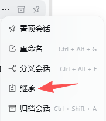
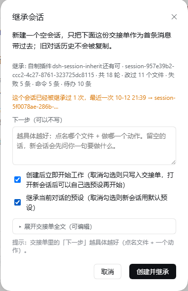
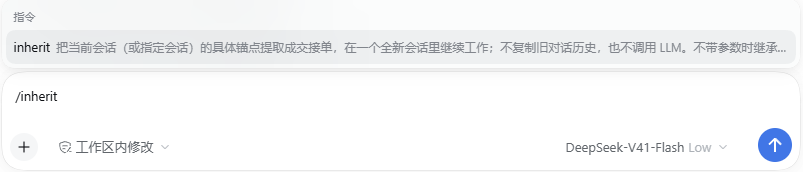

# dsh-session-inherit（继承）

[](https://dsh.market/)

[English](README.md) | [简体中文](README.zh-CN.md)

把一段跑了很久的会话，交接给一个**干净的新会话**。

在会话行的「…」菜单里多出一行 **继承**。点它 → 预览一份从源会话机械提取出来的
交接单 → 确认 → 新建一个不带旧历史的会话，把这份交接单作为它的第一条消息发出，
工作在新会话里继续。原会话原样保留。

<p>


</p>

`/inherit` 命令是同一个入口（指令提示里能搜到）：

<p>

</p>

```
置顶          ← DSH 原版（Pin）
重命名        ← DSH 原版（Rename）
分叉          ← DSH 原版（Fork）
继承          ← 本插件（order 350）
归档          ← DSH 原版（Archive）
```

除「继承」外的四行都是 DSH 原版自带的条目（`sidebar.workspaces.session.menu.item`
slot 的官方内容）。如果装了别的会话菜单插件，你的列表里还会多出它们的条目——
本插件只负责「继承」这一行。

---

## 为什么不是 /compact、也不是「分叉」

现在的 DSH 里已经有两条"继续干"的路，但这个需求是第三条：

| 做法 | 它搬过去的东西 | 对本场景的问题 |
|---|---|---|
| `/compact` | 把历史换成摘要，会话不变 | 实测把 541,227 token 压到 25,602，**4 步之内退化又犯了**，重复词还从「做。」变成了「好。」——可见既不是长度的问题，也不是上下文内容的问题 |
| 官方**分叉** | 复制源会话的整段历史前缀 | 等于把退化诱因一起带走，新会话一睁眼就是几十万 token 的历史 |
| **本插件的继承** | 只搬**可核对的具体锚点**，历史一律不带 | 新会话的上下文从几千字符起步 |

## 为什么不用 LLM 做摘要

`/compact` 那次的证据很直接：摘要留下的是"要做验收、要写报告"这类**抽象意图**，
丢掉的恰恰是文件路径、下一步参数这类**具体锚点**。模型攥着几句模糊意图，在抽象层反复
自我告诫，而每次告诫的句式几乎一模一样——这本身就是在喂重复退化。

所以本插件的交接单**一次模型调用都不发**，只做机械提取：任务原文、最近的用户指令
（原话，不改写）、动过的文件、跑过的命令、最后一次待办状态、源会话最后一条回复。
每条都能追回源会话去核对。

交接单开头还写死三条执行规约：

> 不要复述本单，不要总结本单，不要回应"收到/了解了"。
> 读完直接做「下一步」。第一步只做一个具体动作，做完停下汇报；不要同时铺开多个方向。

## 交接单长什么样

交接单正文的语言**跟随界面语言**（客户端在 preview/commit 请求里带 `lang`）：中文界面
生成中文交接单，英文界面生成英文交接单——不然英文用户拿到的正文，他自己和模型都读不顺。
下面这份是中文输出。

```
📋 会话继承单

> 来源：`session-xxx`（标题） · 共 15 轮 · 最后活动 2026-10-08 19:37
> **执行规则**：不要复述本单…

## 任务目标                    ← 源会话第一条真实用户消息
## 改过的文件（实际写入/修改过）  ← 来自 edit/write 的 file_path，按最近改动排序
## 最近失败                    ← 源会话最后几次工具报错（带轮次与错误码）
## 最近的用户指令（由旧到新）     ← source.kind === 'user' 的原话
## 读过的文件（只读取过，未修改）
## 文中提到的路径               ← 工具参数正文里扫出来的，可能是噪音
## 项目内相对引用               ← 基准目录未确定，需要时用文件搜索确认
## 最近执行的命令
## 待办（源会话最后一次 todo 状态）
## 源会话最后一次回复
## 下一步                     ← 你在预览框里写
```

章节标题**不带序号**。序号是逐节写死的字面量，会随"某一节有没有内容"漂移——
早先版本里客户端提示写死了「## 7. 下一步」而实际生成的是「## 8.」，用户照着找
永远找不到。

「最近的用户指令」只认 `source.kind === 'user'`。实测某个真实会话的 42 条
`user/message` 里，有 27 条是 `agent-instructions` / `runtime-context` /
`skill-catalog` / `time-context` / 记忆提示 / 模型选择 / 压缩检查点 这类运行时注入
——全是噪音，现在被挡在门外。

### 两个高价值锚点

**改过的文件**只取 `edit` / `write` 这类写入工具的结构化 `file_path`。实测某真实
会话：写入类调用 85 次、读取类 58 次，改过 17 个文件、读过 43 个——两类混在
一起时，读过的文件会把真正改过的挤出上限。`write` 的 `content`、`edit` 的
`new_string` 正文里出现的路径只算「文中提到」。

**最近失败**来自 `tool/result` 的 `isError`。实测某真实会话 374 条 `tool/result`
里 11 条失败，形如：

```
- (t5) `edit` FS_STALE_VERSION：cannot write "…\inject-codex.ps1": file changed since it was read — re-read the file, then retry
```

每条都带**轮次**——同一节里的失败可能横跨好几轮，不标轮次的话新会话分不清哪些是
陈年旧账。这是"接着干什么"最直接的线索，而且纯机械可提取。成功的 363 条、以及
用户主动打断（`AbortError`）和自动审查被中断这类噪音会被丢掉；同一条报错在多个
工具上重复出现时按文本合并。

绝对路径锚点还会做一次存在性检查，已被删除或改名的会标上 **（已不存在）**——省掉
新会话去翻一个不存在的文件。

## 用法

### 入口一：会话行菜单

1. 鼠标移到侧边栏任一会话，点行尾的「…」；
   **对哪个会话点都行，包括已经冷掉的会话**（读取走 `sessionQuery.readSession`，不激活 agent）。
2. 点 **继承**。
3. 弹出预览，从上到下是：源会话信息（标题 / 轮次 / 改过几个文件 / 失败几条 / 命令数 / 待办数）
   → **「下一步」输入框**（可以不写）→「创建后立即开始工作」勾选框 →「继承当前对话的
   预设」勾选框 → 一行折叠着的交接单。
4. 在「下一步」里写要它做的事——**越具体越好**（点名哪个文件、做哪一个动作），
   然后点「创建并继承」。要改交接单全文时，点「▸ 展开交接单全文（可编辑）」。
   交接单默认折叠是因为多数时候你只想写一句话，不想逐字审阅几千字。

新会话会自动打开，标题是 `继承: <源标题>`，工作目录、模型路由、agent preset 默认
都跟源会话一致；不想继承预设就在预览框里取消那个勾，新会话改用 DSH 默认预设。

勾选框「创建后立即开始工作」默认勾上：交接单会经
`sessionController.prompt` 作为一条正常用户消息发出并立刻开始。
取消勾选时改为直接写入会话日志（`session:append`），只记录、不触发首轮，
打开后你自己说要做什么。

「下一步」输入框和交接单是**两个独立来源**：宿主收到 commit 时，如果两者都在，
会把输入框的内容写进那份交接单的「## 下一步」一节——所以即使你展开改过交接单，
也不会有哪一边被悄悄丢掉。

**降级会明说。** 如果宿主没能自动开始（`prompt` 失败或不可用），对话框不会静默
关掉，而是停在原地显示原因和新会话 id，并给一个「打开新会话」按钮——以前这里只
写 `console.warn`，界面静默消失，用户会以为新会话已经在跑了。

**重复继承会被提醒。** 源会话（常常是冷的）**改不了标题**：
`sessionTitle.rename(session, title)` 的契约要求传入活着的 session 对象（内部断言
`ctx.sessions.get(id) === session`），而 `sessions.get` 的文档写明"冷会话返回
`undefined`"。所以"这个会话被继承到哪儿去了"记在
`%DSH_HOME%\session-inherit\history.json`，在你再次点开预览框时提示
「这个会话已经被继承过 N 次，最近一次 …→ …」——正好是你准备再次继承的那一刻。
记录只存会话 id 和时间戳，最多保留 200 个源会话、每个 10 条。

### 入口二：`/inherit` 命令

```
/inherit                                  继承当前会话
/inherit <sessionId>                      继承指定会话
/inherit --next 先跑一次 npm test          继承当前会话，并指定第一步
/inherit <sessionId> --next 换个文件继续    两者一起用
```

不带 `--next` 的裸文本只可能是会话 id，不合法就如实报错，不会被猜成"下一步"。

### 入口三：`session_inherit` 工具

注册给 agent 的同名工具，参数 `sessionId`（必填）、`nextStep`、`start`。
用途是让 agent 自己在上下文变长时提议换会话，或让用户通过 agent 表达意图。

三条入口最终走同一条链路：读源会话 → 机械提取 → 新建会话 → 挂工作区 → 注入交接单。

### 回查源会话：`session_read` 工具

交接单首行写着源会话编号，但新会话**没法直接读它**：会话日志是
`%DSH_HOME%\sessions\<工作区转义>\session-<id>\session.vN.jsonl.zstd`，多帧 zstd 拼接
（实测 2.7MB 文件切成 1067 帧，Node 的 `zstdDecompressSync` 只解第一帧就停）。
所以本插件另外注册了一个**只读**工具补上这一环：

```
session_read { sessionId, mode: 'search' | 'summary' | 'tail', query?, limit? }
```

- `search`（默认）：按关键词搜源会话，返回命中处前后各一段上下文
- `summary`：结构化摘要（任务目标 / 改过的文件 / 最近失败 / 待办 / 最后一次回复）
- `tail`：最后 N 个有内容的事件——看"上次到底停在哪"

新会话遇到"交接单里那个文件是干什么的"这类问题时可以直接回查，不用你回去翻。
它只读，不创建也不修改任何东西。

> 「附上原对话编号、让新对话顺着编号去找」这个想法的闭环就在这儿：光有编号没用，
> 得让它读得到。

## 安装

本插件没有发布到 npm，从仓库直接装。改 profile 的 `package.json`，两处都要加：

```json
{
  "dependencies": {
    "dsh-session-inherit": "link:/path/to/dsh-session-inherit"
  },
  "dsh": {
    "profile": {
      "bundles": [
        "dsh-session-inherit"
      ]
    }
  }
}
```

`bundles` 才是加载权威——只写进 `dependencies` 不会挂载。装完重启 DSH。

> 桌面端的 profile 由 Electron 独占管理，全局 CLI 会拒绝操作它；
> 那种情况直接改该 profile 的 `package.json` 再重启即可。

## 版本适配

在 **DSH 0.2.0-rc.2**（Windows）上验证通过。插件依赖若干 DSH 内部服务与菜单
slot 名，DSH 升级后可能失配。如果菜单项不出现、或插件页显示「异常」，先查
profile 的 `compatibility.json`——profile 启动时会校验插件对 `@deepseek-ai/dsh`
与 `dsh-*` 的 peerDependencies，不满足的 bundle 会被整体跳过（日志里打印
`skipping profile bundle`）。把当前 DSH 版本加进 `compatibility.json` 的允许
列表即可。

## 组件构成

- 宿主半 `index.mjs`：注册 `POST /__session-inherit/preview` 与
  `POST /__session-inherit/commit`（同源校验，仅本机 loopback 使用）
- 客户端半 `client.js`：注册
  `sidebar.workspaces.session.menu.item`(id `session-inherit`, order 350) 与
  `shell.overlay` 上的预览对话框

只消费公开服务：`agents`（硬依赖）、`sessionQuery`、`sessionController`、
`workspaceRegistry`、`sessionTitle`、`agentPresets`、`agentDefaultModel`、`webServer`。
除 `agents` 外全部按需查找，缺一个就降级一项，不会让整个插件失活。

## 配置

profile 的 `cordis.patch.yml` 里可以覆盖（全部可选）：

```yaml
- id: session-inherit
  config:
    enabled: true        # false = 完全不注册
    recentUsers: 6       # 交接单里带多少条最近的用户指令（1–50）
    startByDefault: true # 预览框里那个勾选框的默认值
    cacheTtlMs: 120000   # preview → commit 之间复用一次日志读；0 = 不缓存
```

## 已知限制（如实说）

- **它不治退化本身。** 退化是在生成当前这一步犯的，属于解码层；本插件做的只是换一个
  不带旧上下文的干净会话接着干，把"长历史 + 抽象意图"这两个诱因拿掉。新会话第一步
  照样可能退化——那是解码层的事，交给在生成侧检测重复并中止的独立插件
  （如 `dsh-degen-guard`），本插件不碰。
- 交接单是机械提取，不会替你想"下一步"。空着的话模型会先问你一句，这也是故意的。
- 源会话的第一条用户消息如果是很短的寒暄/引言，它就会以原样出现在「任务目标」里。
- **"最后一段含空格"的路径要靠边界识别。** 路径解析分三条路，按可靠性排序：
  ① 工具的结构化参数（`read` / `grep` 的 `path`）整串就是路径，最可靠；
  ② 被引号/反引号包起来的整段，边界明确；③ 剩下的靠正则扫，而正则的末段不允许
  含空白（否则会把后面的句子一起吞掉）。所以路径直接嵌在中文句子里、后面紧跟
  说明文字时（`X:\work\My Project Name 这个项目`），会被
  截断成 `X:\work\My Project`。实测某真实会话里这类残留约 4 处，都在「文中提到的
  路径」这一节（标题已注明"可能是噪音"）。
- 同一行里用空格相连的两个路径会被当成一个——已用"中间段不允许出现盘符冒号"
  挡住 `copy X:\p\a.cs X:\p\b.cs` 这种；中文标点（`，。；：、！？（）【】《》`）
  也作为分隔符处理。
- 交接单上限 14,000 字符。**超长时按优先级整节丢弃**（先丢「文中提到的路径」→
  「读过的文件」→「项目内相对引用」→「命令」→「最后一次回复」→「待办」→
  「最近的用户指令」→「改过的文件」），「下一步 / 任务目标 / 改过的文件 /
  最近失败」永不丢弃。实测一个 1976 事件的长会话生成 4,425 字符，只占上限 32%，
  基本不会触发。
- **各节上限按信息密度定，不是拍脑袋。** 在同一份真实会话上量过：交接单 6,235 字符里
  「最近执行的命令」独占 23.9%，而它的内容是 180 字符处硬切的 PowerShell 长脚本碎片
  ——读不全，也重跑不了；「读过的文件」+「文中提到的路径」再占 26.8%。收紧后是
  改过 16 / 读过 8 / 提到 6 / 相对引用 6 / 命令 5 条×120 字符 / 待办 12 / 失败 5 条×200 字符，
  **核心四节只收紧长度、不砍条数**。同一份会话从 6,235 降到 4,425 字符（**−29%**）。
  交接单是新会话的首条消息、每轮都会重发，省下来的每一段都是持续成本。
- 源会话做过上下文压缩（`compaction/*`）时，交接单会标注一句——压缩之后更早的
  原文已经不在日志里，机械提取自然也就取不到。
- **源会话用的自定义预设默认就会带过去。** 有些预设（比如第三方角色扮演类）**不改**会话
  header 的 `agentPreset`（那里可能一直是 `standard`），真正生效的预设记在宿主的
  `%DSH_HOME%\.agent-presets\session-bindings.json` 里，形如
  `{"session-xxx": "preset-xxxxxxxx"}`。对话框里有「**继承当前对话的预设**」勾选框，
  默认勾选：勾着的时候插件会把这个 preset id 当作新会话的 `agentPreset` 在**创建时**
  传进去，新会话一开场就是那个预设；取消勾选则新会话用默认预设。交接单页脚如实写明
  结果——`预设：preset-… → 新会话已继承该预设`，或「本次未继承」「挂载失败」。
- **真正完成继承的不是某个预设插件的 HTTP 接口。** 比如 `dsh-tavern` 的
  `POST /api/tavern/bind-preset` 只写它自己的绑定账本，源码注释写明「真正切换 agent
  预设请用聊天顶部选择器」。插件仍然会调它，目的是让账本保持一致；真正的继承走的是
  宿主的 `agentPresets` 服务、在会话创建时完成。上一版把这两件事搞反了，于是出现
  「交接单页脚写着绑定了预设、新会话却没有人格」。

## 测试

```sh
node test/extract.test.mjs   # 提取器纯函数（32）
node test/host.test.mjs      # 宿主半：假 ctx 跑通端点注册、preview/commit 全链路、/inherit 参数解析、预设继承、继承记录（18）
node test/client.test.mjs    # 客户端半：模块协议、slot 注册、降级菜单行，以及菜单→preview→折叠/展开→确认→commit 全链路（5）
```

## 发布

每次发版要**同时**传两个附件：

- `dsh-session-inherit-<版本>.tgz` —— 留档
- `dsh-session-inherit.tgz` —— **固定名**

固定名那个是给 `releases/latest/download/dsh-session-inherit.tgz` 用的。`latest` 指向
**最新那个 Release**，附件名不带版本，市场里写好的安装命令才不会随发版失效——少传它，
那个 URL 下次发版就是 404。

```sh
npm test                  # 1) 改完代码，跑测试
# 2) bump 版本 → 提交推送 → 打 tag（脚本会校验 tag 与 package.json 的版本一致）
node scripts/release.mjs  # 3) 打包 + 建 Release + 传两个附件
```

`--dry-run` 只列包内容、不打包不上传；`--tag v1.2.3` 显式指定 tag。脚本不碰 git——
提交和打 tag 仍由你手动做，它只管打包与上传。

## 与已有插件的关系

写之前查过现成的方案，没有完全重合的：

- **[WeiYe6/dsh-session-handoff](https://github.com/WeiYe6/dsh-session-handoff)**（`dsh-session-handoff`）
  最接近：`/handoff` 命令，同工作区新建会话 + 注入交接文档 + 自动打开。差别是它
  用 LLM 总结最近 N 轮，而且只能在**当前会话**里敲命令；本插件的入口在会话行菜单，
  对任意（含冷）会话可用，且不调模型、只搬具体锚点。
- **[ZhijiangTang/dsh-handoff](https://github.com/ZhijiangTang/dsh-handoff)**：
  确定性地导出一份 `HANDOFF.md`，但不建新会话。
- **[liangmianya/dsh-synapse](https://github.com/liangmianya/dsh-synapse)**：
  可视化会话地图，按 DSH 原生 fork 关系连线——走的是"带上全部历史"的那条路。
- **`@michengai/dsh-archive-manager`**：它还往同一个菜单里注册了 `delete-session`
  （order 500）。本插件用 order 350，两者不冲突。

## License

MIT
